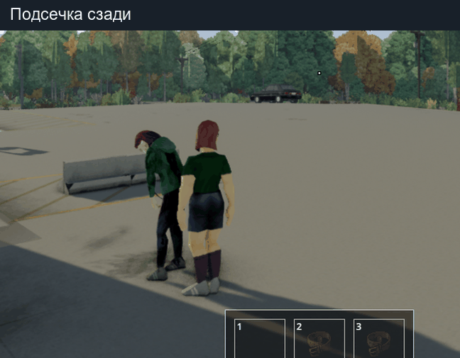

# Viewpoint Finishers 0.4.0

Аддон для **Project Zomboid 42.21.0**, одиночная игра. Добавляет пять постановочных добиваний с собственными парными анимациями игрока и зомби. Поддерживает обычную камеру и Project Viewpoint.

[Скачать готовый мод v0.4.0](https://github.com/maleoipTu/ViewpointFinishers/releases/tag/v0.4.0). Для установки нужен архив `ViewpointFinishers-0.4.0.zip` из раздела Assets.



[Посмотреть захват, удар по ноге и добивание ножом](validation/gameplay-preview-0.3.1.gif).

## Добивания и управление

Подойдите к живому зомби на расстояние до 1,25 клетки, остановитесь и нажмите **K**:

- **Сзади стоящего зомби:** захват, движение рук к голове и сворачивание шеи.
- **Спереди стоящего зомби:** удар по ноге, опускание противника на колено и завершающий удар в голову.
- **У лежащего на спине зомби, с ножом:** подход к голове, приседание, удержание и удар ножом.

**Shift + K** у стоящей цели выбирает один из двух новых приёмов. Сзади персонаж переносит вес на опорную ногу, придерживает плечо и подсекает голень. Спереди он подшагивает и толкает зомби обеими ладонями в грудь. Оба приёма также доступны по названию в контекстном меню. При переназначении клавиши удерживайте Shift вместе с новой клавишей.

Для парного добивания персонаж сам делает короткий подход к нужной точке. Телепортации нет. Сбоку стоящего противника нужно сместиться вперёд или назад. Клавиша переназначается в настройках управления; также доступно контекстное меню. Меню выбирает ближайшую допустимую цель, а не объект под курсором.

Для остальных лежащих целей сохранены восемь профилей штатных движений PZ: нога, нож, одноручное, двуручное и тяжёлое оружие, копьё, удар ногой с винтовкой или пистолетом. Огнестрельное оружие не стреляет при добивании.

## Механика

Смертельный удар привязан к событию клипа. Выносливость расходуется при начале, при отмене не возвращается. Движение, бег, прицеливание, смена предмета и полученный урон прерывают действие. Неуязвимости нет. Проверяются расстояние, этаж, препятствия и состояние цели. При отмене снимается удержание зомби; защитный таймаут — 8 секунд.

Ползущие, встающие зомби, цели под машинами и сетевой режим исключены. В одиночной игре смерть проходит через штатный Hit и OnHitZombie. Аддон не заменяет файлы Viewpoint / Proper Ragdolls и не создаёт труп вручную.

## Полировка 0.3.0 и исправление 0.3.1

В 0.3.1 исправлено отпускание после захвата: кисти отходят к груди и опускаются вдоль тела, локти уходят вниз ближе к рёбрам. Убрана неестественная поднятая поза рук после падения цели.

Уточнён захват головы, поворот кистей ограничен 25°, локти сохраняют устойчивую плоскость сгиба. Добавлены перенос веса, работа плеч и непрерывное движение между ключевыми позами. Опорные стопы удерживают ориентацию; выход из каждого приёма возвращается в исходную позу. У ножа появились удержание после контакта и отдельный отвод руки.

Три новых клипа смерти продолжают позу момента удара: падение вперёд после захвата, боковое падение с колена, затухание движения лежащей цели. Устранено переключение на случайную стоячую смерть; финальная поза передаётся штатному созданию трупа. Отправляется сигнал завершения Proper Ragdolls, чтобы он освободил свой обработчик смерти.

## Качество и проверка

Это **играбельная альфа с авторской постановкой движений**. Десять парных скелетных клипов содержат разные движения обоих участников. Переходы к падению используют собственные согласованные клипы; труп создаёт игра. Точность контакта рук и ножа зависит от положения цели; кинематографическая полировка и варианты под каждый вид оружия в эту версию не входят.

Проверки и ограничения перечислены в `validation/STATUS.md`. `validation/gameplay-preview-0.3.1.gif` — кадры реальной игры. `animation_source/choreography-preview-0.3.1.gif` — отдельный просмотр авторского движения на манекенах, не игровой видеозапись.

## Установка

Закройте игру. Запустите `Install.ps1` через PowerShell либо скопируйте папку `ViewpointFinishers` в `%USERPROFILE%\Zomboid\mods`. Включите **Viewpoint Finishers** в меню модов и для нужного сохранения. Рекомендуется сначала новый тестовый мир.

Viewpoint, ZombieBuddy и Proper Ragdolls устанавливаются отдельно; чужие моды не включены в архив. Установщик сохраняет резервную копию предыдущего Viewpoint Finishers и проверяет хэши. Настройки активных модов и сохранения он не меняет. Удаление: отключить аддон в меню модов.

## Исходники

- `tools/choreography.py` — исходная постановка, IK, экспорт пятнадцати `.x` клипов. Из установленной игры читается только структура совместимого скелета; движения и техническая геометрия носителя созданы отдельно.
- `tools/build_assets.py` — XML и RU/EN переводы.
- `tools/test.ps1` — проверки правил и отмены в Kahlua PZ с заглушками игровых объектов, а также импорт всех клипов настоящим Jassimp из игры.
- `tools/validate.py` — структура, ссылки на клипы, переводы и состав мода.
- `tools/start_lab.ps1` / `tools/LabScenario.lua` — отдельный тестовый профиль; сценарий в пользовательский мод не входит.
- `animation_source/choreography_animated.blend` — сцена Blender для просмотра и доработки постановки.

Код и анимации подготовлены с помощью OpenAI Codex. Project Zomboid — The Indie Stone. Viewpoint и Proper Ragdolls принадлежат их авторам. Оригинальные игровые клипы, модели, текстуры и библиотеки не распространяются. Лицензия на распространение исходников и авторских анимаций пока не выбрана.

## Проверки и сборка

Скрипты рассчитаны на Windows и локальную установку PZ. Пути к игре и JDK указаны в начале соответствующих скриптов; при другом расположении их нужно скорректировать. Для Python требуются NumPy, а для сборки GIF — Pillow. Для просмотра `.blend` нужен Blender.

```powershell
python tools/validate.py
python tests/choreography_check.py
powershell -ExecutionPolicy Bypass -File tools/test.ps1
python tools/package.py
```

Готовый архив появляется в `dist`. Для повторного экспорта анимаций: `python tools/choreography.py`, затем `python tools/build_assets.py`. Создание GIF из игры требует собственных кадров лабораторного прогона; исходная запись и тестовые сохранения в репозиторий не включены.

При проблемах проверьте `%USERPROFILE%\Zomboid\console.txt` и строки с `[VF]`. Итоги выполненного игрового прогона и границы проверки: [validation/STATUS.md](validation/STATUS.md).
